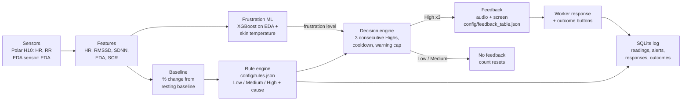

# Team 3: Frustration and fatigue prediction and feedback

**Team 3:** Palash, Andrew, Dean. **Repository:** [github.com/palash1031/VIP_psychological_dashboard](https://github.com/palash1031/VIP_psychological_dashboard) (branch `feature/polar-h10-dashboard`).

The system predicts **Low, Medium or High** frustration risk and fatigue risk from wearable data, and gives feedback under the rules shared by all teams:

- Medium (and Low) risk never triggers feedback.
- High risk triggers feedback only after **3 consecutive High predictions**. A Low or Medium prediction resets the count.

Stress prediction is out of scope.

## Pathway



## Input data and preprocessing

| Signal | Source | Processing |
| --- | --- | --- |
| HR (bpm) | Polar H10 | Mean over the rolling window |
| RMSSD, SDNN (ms) | Polar H10 RR intervals | RR outside 300–2000 ms excluded; successive differences never bridge an excluded beat; SDNN uses n − 1 |
| EDA (µS) | Separate EDA sensor (e.g. Empatica); the H10 has none | Mean over the rolling window |
| SCR (responses/min) | Derived from EDA | Peak detection: a rise of at least 0.01 µS from the preceding trough, counted when the signal turns down |

Each feature is converted to a percentage change from the participant's resting baseline, as the DBR masterfile specifies: `change % = (current − baseline) / baseline × 100`. A zero or missing baseline makes that feature unmeasured. **A missing signal is never treated as normal:** the prediction becomes *Unavailable* and names the missing signals.

The current feature window is the temporary 5-second debugging setting in `config/rules.json` (`featurePolicy`). Use a longer window, such as 60 s, for data collection.

## Prediction rules

All thresholds live in [`config/rules.json`](../config/rules.json), so they can be retuned without code changes. Every condition in a row must hold, comparisons are strict, and the highest matching level wins. Values below the Low thresholds are still predicted Low.

### Fatigue (DBR stress sheet, section 6, Fatigue-Related Stress)

| Level | RMSSD | SDNN | HR | EDA |
| --- | --- | --- | --- | --- |
| Low | < −15% | < −15% | | |
| Medium | < −25% | < −20% | | |
| High | < −35% | < −30% | < +10% | < +15% |

The High rule needs EDA. With only the Polar H10, fatigue can reach Medium, and the system reports that High cannot be assessed.

### Frustration (DBR frustration sheet)

The frustration sheet gives each cause as a pattern of arrows but no numbers. We converted each arrow using the stress-sheet row that has the **same arrow pattern**:

- Rework (↑↑ ↑↑ ↑ ↓ ↓) has the same pattern as Cognitive Overload.
- Schedule Pressure (↑ ↑ ↑↑ ↓↓ ↓↓) has the same pattern as Time Pressure.
- "Slight ↑" uses the caps from the Fatigue-Related row (HR < 10%, EDA < 15%).

The single-↑ SCR value is our assumption, because the stress sheet has no SCR value for a single ↑. We set it equal to single-↑ EDA.

| Arrow | Low | Medium | High | Taken from |
| --- | --- | --- | --- | --- |
| EDA ↑↑ | > 10 | > 20 | > 30 | Cognitive Overload |
| SCR ↑↑ | > 10 | > 25 | > 40 | Cognitive Overload |
| HR ↑ | > 5 | > 10 | > 15 | Cognitive Overload |
| RMSSD/SDNN ↓ | < −10 | < −15 | < −25 | Cognitive Overload |
| EDA ↑, SCR ↑ | > 10 | > 15 | > 25 | Time Pressure (SCR assumed equal to EDA) |
| HR ↑↑ | > 10 | > 15 | > 20 | Time Pressure |
| RMSSD/SDNN ↓↓ | < −10 | < −20 | < −30 | Time Pressure |
| slight ↑ (EDA, SCR / HR) | 0 to 15 / 0 to 10 | same | same | Fatigue-Related caps |

| Cause | EDA | SCR | HR | RMSSD | SDNN |
| --- | --- | --- | --- | --- | --- |
| Rework / Repeated Task Failure | ↑↑ | ↑↑ | ↑ | ↓ | ↓ |
| Schedule Pressure | ↑ | ↑ | ↑↑ | ↓↓ | ↓↓ |
| Equipment / Tool Problems | ↑↑ | ↑ | ↑ | ↓ | ↓ |
| Material Shortage / Waiting Time | slight ↑ | slight ↑ | slight ↑ | ↓ | ↓ |
| Poor Communication / Unclear Instructions | ↑↑ | ↑ | ↑ | ↓↓ | ↓↓ |

Frustration needs all five signals. When several causes match at the same level, the engine reports the most specific one: the rule with the strictest thresholds, measured as the sum of the absolute threshold values. The other matching causes are listed as "also consistent with", so they are not hidden. At Low risk the DBR specifies "any cause", so no cause is reported.

## Frustration ML model

The DBR architecture is *frustration probability = ML(signals)* and *cause = rule engine*. The system follows that split. When a session streams EDA and skin temperature, an ML model sets the frustration level. The rule engine above still names the cause when all five DBR signals are available; otherwise the cause is reported as "not identified". Without a signal stream, the rules alone set the level, as before.

There are two trained models. Switch between them with `modelFile` / `reportFile` in `config/rules.json`.

| Model | Headline accuracy | On new people | Use when |
| --- | --- | --- | --- |
| **Deployed (team decision):** XGBoost, depth 6, 500 trees, unregularised (`models/team3_frustration_seen_model.json`) | **87.5%**, random window split, participants seen in training | 48.9% | The workers are the people in the training data |
| Cautious: Extra-Trees, depth 3 (`models/team3_frustration_model.json`) | **58.1%**, nested leave-one-participant-out (95% CI 38–77%) | 58.1% | The workers are new people |

The deployed model's scores, every way of measuring them (`models/team3_frustration_seen_report.json`):

| Test | Accuracy | What it shows |
| --- | --- | --- |
| Random window split, 5-fold (60 s windows every 10 s) | 87.5% | Headline. Test windows come from people and sessions in the training data |
| Training data itself | 100% | Memorisation ceiling |
| Later part of each session | 68.8% | Train on the first 70% of every session, test on the rest without overlap |
| Same person's other session | 57.3% | A new session from someone in the training data |
| New people (leave one participant out) | 48.9% | Workers not in the training data |
| Fake labels, random split (control) | 86.0% | Each participant gets a random label; a high score means the model recognises the person, not frustration |

The fake-label control is nearly as high as the headline. So most of the 87.5% comes from recognising which person or session a window belongs to. P7 is the only participant with sessions at two different levels, and the cautious tests show the model rarely tells such sessions apart. For workers outside the training data, expect about 49%.

**Data.** The labelled set has 27 sessions from 15 participants, each labelled Low, Medium or High, with Active and Passive conditions, recorded at 1 Hz. The data stays in `.local/data/` and is not committed. Each file's signals are min-max scaled over the whole session, and the BVP column was exported inconsistently (some files averaged per second, some sampled). Matching timestamps against the raw Empatica Avro files confirmed the EDA columns are excerpts of the real recordings (correlation 0.96–0.999 where raw data exists).

**Preprocessing.**
1. Each session is cut into 60 s windows every 30 s. Sessions are capped at 10 minutes, because P11 and P18 run 30–80 minutes and would otherwise dominate.
2. Signals are scaled by the session's **running** min/max up to the end of each window. That uses only past data, needs no resting baseline, and is computed identically by the live server. Replaying the real sessions through the server reproduces the training features exactly (277 windows, difference 0).
3. Training weights every session and every class equally.

**Features.** There are 12, all from EDA and skin temperature:
- **EDA:** mean, standard deviation, slope, range, SCR-like peak rates at two amplitudes, mean absolute change, recent level and skewness.
- **Skin temperature:** mean, slope and standard deviation.

BVP was dropped because of its inconsistent export. HR, RMSSD and SDNN are not in the labelled data, so they feed only the cause rules.

**The cautious model: selection without overfitting.**
- Four families were compared: logistic regression, random forest, Extra-Trees and XGBoost, each with a small, regularised settings grid.
- For each held-out person, the family and settings are chosen by an inner grouped CV over the other 14 people only. The test person never influences the choice.
- The deployed model is the winner of the same procedure on all 15: Extra-Trees with 200 trees, depth 3 and at least 10 windows per leaf.

| Model (nested LOPO) | Accuracy | Macro-F1 | Whole-session vote | Recall Low / Med / High |
| --- | --- | --- | --- | --- |
| Logistic regression | 57.4% | 0.56 | 51.8% | 0.52 / 0.70 / 0.50 |
| Random forest | 55.9% | 0.55 | 51.8% | 0.48 / 0.70 / 0.52 |
| Extra-Trees | 60.2% | 0.59 | 59.3% | 0.53 / 0.75 / 0.52 |
| XGBoost | 51.6% | 0.50 | 55.6% | 0.50 / 0.62 / 0.38 |
| **Full selection procedure (unbiased)** | **58.1%** | **0.56** | **59.3%** | 0.49 / 0.76 / 0.48 |

**Why this is lower than a random-split score.** If windows are split at random, every test person also appears in training. Each person has essentially one label, so the model can recognise the person instead of frustration. The same deployed model scores **69.2%** that way, and an earlier exploration with XGBoost reached 77–79%. Those numbers do not carry over to new workers. XGBoost does best on a random split and worst on unseen people, which is a sign of memorisation. Per-person accuracy ranges from 0% to 100%; the full table is in the report.

**Retrain, evaluate, replay:**

```bash
python3 -m pip install -r requirements.txt                        # numpy, scikit-learn, pandas, xgboost
python3 training/train_frustration_model.py                        # deployed model (--profile seen); data in .local/data/Frustration
python3 training/train_frustration_model.py --profile unseen       # cautious model, nested leave-one-participant-out
python3 tools/replay_frustration.py P15_Passive_High               # replay with a model that never saw P15
python3 tools/replay_frustration.py P15_Passive_High --deployed-model   # replay with the deployed model
```

Training writes `models/team3_frustration_seen_model.json` and `models/team3_frustration_seen_report.json` for the deployed profile. The `--profile unseen` run writes `models/team3_frustration_model.json` and `models/team3_frustration_report.json`.

Models are portable JSON, so inference needs no ML libraries; the deployed model takes 1.7 ms per prediction. The dashboard shows the configured report under "Frustration ML model".

## Empatica data from AWS (delayed)

The EmbracePlus wristband uploads raw Avro files to the study's S3 bucket in **30-minute files**, so its data reaches the platform 30–60 minutes late. That is too late for in-the-moment feedback. [`tools/empatica_bridge.py`](../tools/empatica_bridge.py) pulls each new file and converts it into one sample per second:

- **EDA:** the mean of the 4 Hz values in that second.
- **Skin temperature.**
- **Beat-to-beat intervals:** from Empatica's detected heartbeat peaks, which also give HR, RMSSD and SDNN.

Samples are sent in **`batch` mode**. Levels, causes and High streaks are computed and saved like live data. A cue that live data would have triggered is recorded as `wouldAlert`, with the same 3-consecutive rule, cooldown and cap, but it is never sent. Late *live* data no longer feeds the frustration model.

```bash
python3 -m pip install -r requirements-empatica.txt     # boto3, fastavro, python-dotenv
python3 serve_dashboard.py
python3 tools/empatica_bridge.py --url http://127.0.0.1:8000 --participant 11 \
    --since 2026-11-03T14:00 --session-id P21-drywall --poll 60
# then open http://127.0.0.1:8000/serving/dashboard.html?session=P21-drywall
```

How to set it up:
- **AWS access.** The keys come from `.env` (`AWS_ACCESS_KEY_ID`, `AWS_SECRET_ACCESS_KEY`, `AWS_REGION`). The bucket and prefix are the same as in `avro_stream_poller_with_ml.py`.
- **Participant IDs.** `--participant` is the device enrolment (folder `11-3YK3K151Y5` → `11`). Enrolments are reused across people, so record which person wore which device and when.
- **Sessions.** Give each experiment session its own `--since`/`--until` and `--session-id`. The ML features are scaled by the range seen since the session started, so a whole-day session drifts.
- **Offline use.** `--source local` reads a downloaded copy with the same folder layout.
- **Delayed sessions on the dashboard.** These show as "DELAYED · EMPATICA BATCH". Cues that would have fired appear as ◇ in the timeline.

**Check against the labelled data.** I ran labelled sessions through the bridge from their raw files and compared the model's predictions with those from the training CSVs. Where a labelled CSV matches its raw recording, the predictions agree 95–100% of the time; across all sessions they agree 83%. The disagreements are sessions whose labelled files do not match the raw data well (P9, P10-Passive, P11).

## Feedback logic

The decision engine is [`pipeline/decision.py`](../pipeline/decision.py) and its settings are in [`config/feedback_table.json`](../config/feedback_table.json):

1. A Low or Medium prediction never issues feedback and sets the High count to 0.
2. Each High prediction adds 1 to the count. On the 3rd consecutive High, feedback is issued for the predicted cause, and the count then restarts.
3. An Unavailable prediction, or a gap longer than 5 s between predictions, also resets the count, because consecutiveness cannot be confirmed.
4. To limit alarm fatigue, there is a 120 s cooldown per state and at most 3 alerts per 10 minutes. These two values are provisional study settings.

High feedback text is taken from the DBR masterfile:

| State | Cause | Message (spoken and shown) | Closed-loop task action |
| --- | --- | --- | --- |
| Frustration | Rework / Repeated Task Failure | "Pause and reassess the task. Work through one step at a time." | Temporarily simplify task; provide additional guidance |
| Frustration | Schedule Pressure | "Prioritize the next important step. Keep a consistent pace." | Reschedule lower-priority activities |
| Frustration | Equipment / Tool Problems | "Pause while the issue is addressed. Consider available alternatives." | Switch task or reassign equipment |
| Frustration | Material Shortage / Waiting Time | "Review upcoming activities and organize tools and materials." | Assign preparatory work |
| Frustration | Poor Communication / Unclear Instructions | "Verify the instructions before continuing." | Require task confirmation before execution |
| Frustration | Cause not identified (ML says High, cause rules lack evidence) | "Pause and reassess the task. Work through one step at a time." | Check in with the worker; simplify the task or provide guidance (implementation choice, not a DBR row) |
| Fatigue | Fatigue-Related Stress | "Take a short recovery break if safe." | Trigger micro-break recommendation |

Feedback is delivered as on-screen text and through browser speech. The worker can answer with Acknowledge, I took a break or Not helpful, and can then report Better, The same or Worse. Every reading, alert, response and outcome is stored in a local SQLite database and can be exported as session JSON.

## Running it

```bash
python3 serve_dashboard.py
# Team 3 dashboard:   http://127.0.0.1:8000/serving/dashboard.html
# Polar H10 platform: http://127.0.0.1:8000/psychosocial_dashboard.html
python3 tools/demo_stream.py          # the same scripted demo in the terminal
```

The dashboard's scripted demo comes from [`config/demo_scenario.json`](../config/demo_scenario.json):

1. Rest: Low.
2. Frustration rises to Medium: no feedback.
3. Two Highs, then a Medium: the count resets.
4. Three Highs: frustration feedback.
5. Recovery.
6. Fatigue rises to Medium: no feedback.
7. Three High fatigue predictions: fatigue feedback.
8. Recovery.

"Try your own values" sends custom % changes. "Follow live Polar session" shows predictions from a connected H10.

## Testing

| Suite | Command | Result |
| --- | --- | --- |
| Python (rules, timing, ML, Empatica bridge, storage, API) | `python3 -m unittest discover -s tests -p 'test_*.py'` | 127 passed, 2 skipped (optional-dependency branches) |
| JavaScript (sensor decoding, HRV, browser rules) | `npm test` | 63 passed |
| Browser (built panel and real local API) | `npx playwright test` | 12 passed |

[`tests/test_pipeline.py`](../tests/test_pipeline.py) contains:

- one boundary check per frustration threshold (every cause and level, exact boundary versus just inside);
- the fatigue thresholds;
- cause selection for all five causes;
- one test per timing rule: Medium silent, 3rd High alerts, reset on Low, Medium, Unavailable and gaps, duplicates ignored, restart after an alert, cooldown, warning cap, configurable count;
- an end-to-end run of the scripted demo.

[`tests/test_frustration_model.py`](../tests/test_frustration_model.py) checks:
- the ML features against numpy and pandas;
- that the features are scale-free;
- that the live tracker waits for a full window;
- that the exported logistic, Extra-Trees and XGBoost models reproduce the library probabilities;
- that a streamed EDA session drives the ML level and the 3-consecutive-High feedback.

Frustration prediction accuracy is reported in the ML section above. Fatigue accuracy is not measured, because there is no labelled fatigue data yet.

## Limitations

- **The deployed model's 87.5% applies only to people it trained on.** On new people it scores 48.9%, and a fake-label control scores 86%, which shows the headline is mostly person recognition. The cautious model scores 58% on new people (95% interval 38–77%, only 15 participants). Labels are per session, so every window inherits its session's label. More participants would help more than any model change.
- **The cause rules are not validated.** The frustration cause thresholds are derived from stress-sheet rows with matching arrow patterns, not from labelled cause data. Fatigue has no labelled data at all.
- **The ML model needs an EDA and skin-temperature stream.** The Polar H10 provides neither. The EmbracePlus provides both, but only through 30-minute cloud uploads, so its frustration predictions are delayed and never trigger live feedback. The labelled data is 1 Hz and session-scaled, so a raw 4 Hz Empatica stream is averaged to 1 Hz before computing features.
- **Causes overlap.** Several frustration patterns are subsets of others, and "slight ↑ with ↓ HRV" (Material Shortage) resembles the fatigue pattern. Physiology alone cannot tell causes apart reliably. The DBR's own architecture adds task context and shift duration, which are not yet inputs.
- **Polar-only sessions are limited.** The H10 has no EDA. Frustration is Unavailable and fatigue tops out at Medium unless an EDA sensor is connected.
- **SCR in short windows is coarse.** In a 5-second window, SCR rate changes in large steps, and a resting baseline with no responses leaves SCR unmeasured.
- **"Consecutive" depends on prediction rate.** At about one prediction per second, 3 consecutive Highs take about 3 s. The DBR's 60–120 s duration would correspond to roughly one prediction every 30 s.
- **Fatigue is rules-only, and ML and rules are not blended for frustration.** The labelled set has no resting baseline or HR/HRV, so the rules cannot be scored on it and a blend cannot be validated. The ML model therefore sets the level, and the rules only name the cause.

## Source files

| File | Role |
| --- | --- |
| [`config/rules.json`](../config/rules.json) | Thresholds for each state, cause and level |
| [`config/feedback_table.json`](../config/feedback_table.json) | Consecutive-High count, cooldown, warning cap, feedback text per level and cause |
| [`config/demo_scenario.json`](../config/demo_scenario.json) | Scripted demo |
| [`pipeline/features.py`](../pipeline/features.py) | HRV, SCR peak rate, baseline, % change |
| [`pipeline/rule_engine.py`](../pipeline/rule_engine.py) | Low/Medium/High and cause selection |
| [`pipeline/decision.py`](../pipeline/decision.py) | Consecutive-High feedback decisions |
| [`pipeline/feedback_pipeline.py`](../pipeline/feedback_pipeline.py) | Per-sample chain for frustration, fatigue and posture |
| [`pipeline/frustration_model.py`](../pipeline/frustration_model.py) | ML features (shared with training), live EDA/temperature tracking, portable model inference |
| [`training/train_frustration_model.py`](../training/train_frustration_model.py) | Nested leave-one-participant-out comparison of four model families; exports model and report |
| [`models/team3_frustration_seen_model.json`](../models/team3_frustration_seen_model.json), [`models/team3_frustration_seen_report.json`](../models/team3_frustration_seen_report.json) | Deployed frustration model (seen participants) and its evaluation report |
| [`models/team3_frustration_model.json`](../models/team3_frustration_model.json), [`models/team3_frustration_report.json`](../models/team3_frustration_report.json) | Cautious frustration model (unseen participants) and its report |
| [`tools/replay_frustration.py`](../tools/replay_frustration.py) | Replays a labelled session through the live pipeline with a held-out model |
| [`tools/empatica_bridge.py`](../tools/empatica_bridge.py) | Pulls EmbracePlus raw data from S3 and feeds it to the server as delayed `batch` data |
| [`tests/test_empatica_bridge.py`](../tests/test_empatica_bridge.py) | Avro conversion, file handling, batch mode and late-data tests |
| [`tests/test_frustration_model.py`](../tests/test_frustration_model.py) | ML feature, export and pipeline tests |
| [`serving/server.py`](../serving/server.py) | `/samples`, `/latest`, `/feedback`, `/summary`, `/export` |
| [`serving/dashboard.html`](../serving/dashboard.html) | Team 3 dashboard (display, audio, feedback buttons) |
| [`storage/sqlite_store.py`](../storage/sqlite_store.py) | Readings, alerts, responses, outcomes |
| [`training/build_feedback_table.py`](../training/build_feedback_table.py) | Builds the feedback table from a CSV/XLSX sheet ([`config/feedback_template.csv`](../config/feedback_template.csv)) |
| [`tools/demo_stream.py`](../tools/demo_stream.py) | Scripted replay without hardware |
| [`sensor/study-panel.js`](../sensor/study-panel.js), [`sensor/closed-loop-panel.js`](../sensor/closed-loop-panel.js) | Polar H10 platform panel |
| [`tests/test_pipeline.py`](../tests/test_pipeline.py) | Threshold, timing and end-to-end tests |
