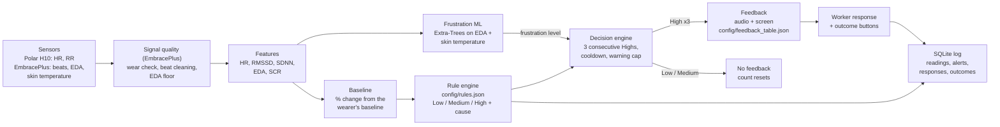

# Team 3: Frustration and fatigue prediction and feedback

**Team 3:** Palash, Andrew, Dean. **Repository:** [github.com/palash1031/VIP_psychological_dashboard](https://github.com/palash1031/VIP_psychological_dashboard) (branch `feature/team3-frustration-fatigue`).

The system predicts **Low, Medium or High** frustration risk and fatigue risk from wearable data, and gives feedback under the rules shared by all teams:

- Medium (and Low) risk never triggers feedback.
- High risk triggers feedback only after **3 consecutive High predictions**. A Low or Medium prediction resets the count.

Stress prediction is out of scope.

## Pathway



## Input data and preprocessing

| Signal | Source | Processing |
| --- | --- | --- |
| HR (bpm) | Polar H10 | Mean over the rolling window |
| RMSSD, SDNN (ms) | Polar H10 RR intervals | RR outside 300–2000 ms excluded; successive differences never bridge an excluded beat; SDNN uses n − 1 |
| EDA (µS) | Separate EDA sensor (e.g. Empatica); the H10 has none | Mean over the rolling window |
| SCR (responses/min) | Derived from EDA | Peak detection: a rise of at least 0.01 µS from the preceding trough, counted when the signal turns down |

Each feature is converted to a percentage change from the participant's resting baseline, as the DBR masterfile specifies: `change % = (current − baseline) / baseline × 100`. A zero or missing baseline makes that feature unmeasured. **A missing signal is never treated as normal:** the prediction becomes *Unavailable* and names the missing signals.

The Polar H10 path still uses the temporary 5-second debugging window in `config/rules.json` (`featurePolicy`); use a longer window, such as 60 s, for data collection. EmbracePlus data uses its own settings (`sourcePolicies`), described next.

## Signal quality (EmbracePlus)

Wrist data is much noisier than a chest strap, and the original pipeline treated it the same way. Each fix below was checked on real recordings from the study bucket: 11 person-days, 3,910 worn and 1,758 unworn minutes. All values are in `config/rules.json` under `sourcePolicies`.

**Wear check.** Empatica publishes a per-minute `wearing_detection_percentage`, which the bridge now reads; a minute under 50% counts as not worn. Until that file is published, skin temperature decides: below 27 °C means off the wrist. Nothing is predicted from unworn seconds, and they never reach the model's scaling.

| Rule (per minute) | Worn minutes kept | Unworn minutes let through |
| --- | --- | --- |
| Temperature at least **27 °C** (used) | 98.4% | 6.1% |
| Temperature at least 30 °C (published value, for another sensor) | 79.1% | 3.5% |
| EDA at least 0.05 µS | 83.2% | 3.4% |

[Kleckner et al. 2018](https://pmc.ncbi.nlm.nih.gov/articles/PMC5880745/) set 30–40 °C for a different wristband. This device reads cooler, so 30 °C would discard a fifth of worn data, and 27 °C comes from the table above.

**Beat cleaning.** Systolic peaks miss beats, so one interval reads about double (650, 1300, 640 ms). Those pass the 300–2000 ms range check, and each creates huge successive differences. An interval is now kept only if it is within 20% of the median of the 5 intervals on each side, the common clinical 20% rule applied against a local median. A rejected beat breaks the sequence, so no difference is computed across it. HR uses clean beats too.

If under 60% of a window's beats are clean, RMSSD and SDNN are reported as not measured instead of as a noisy number. That threshold trades coverage for plausibility:

| Minimum clean beats | Worn minutes with HRV | Median RMSSD | 90th percentile RMSSD |
| --- | --- | --- | --- |
| 50% | 80% | 69 ms | 103 ms |
| **60% (used)** | 66% | 65 ms | 99 ms |
| 70% | 53% | 61 ms | 93 ms |
| 80% | 40% | 56 ms | 86 ms |

The check against Empatica's own numbers is mixed, and worth reading carefully. Empatica publishes RMSSD only for still minutes with a good signal: 707 usable minutes across the bucket, from 22 people, 619 of them from one person.

| Against Empatica's RMSSD | Range check only | With cleaning |
| --- | --- | --- |
| All 707 minutes: mean error | 30.0 ms | 37.0 ms |
| All 707 minutes: bias | +9.1 ms | −32.5 ms |
| All 707 minutes: rank correlation | 0.74 | **0.83** |
| Without the dominant person (88 minutes, 21 people): mean error | 56.0 ms | **33.2 ms** |
| Without the dominant person: rank correlation | 0.46 | **0.76** |

Cleaning **reads low**: a fixed 20% also trims real variation, especially at high HRV. A steady offset matters less here, because rules compare each person with their own baseline. On clean minutes from that one person, the absolute error gets worse. During motion, where Empatica publishes no RMSSD, the only reference is its pulse rate: over 3,770 worn minutes, HR error fell from 11.9 to 8.9 bpm and correlation rose from 0.41 to 0.54.

**Personal baseline.** The baseline used to be the first window of the session, 5 seconds long. Noise there set everything after it: a 512 ms RMSSD, a 144 bpm HR, and an EDA of 2.47 µS that made the next hours read −96%. EDA also keeps rising after the band goes on: over long worn stretches, the 60 s mean sat a median of 47–1821% from the first minute. So the baseline is now the median of each signal over the wearer's last 20 minutes, skipping the most recent 60 s, and needs 2 minutes of history first. It is ready about 4 minutes into a session.

**EDA floor.** A 60 s mean below **0.05 µS**, the lower limit in Kleckner et al., is reported as not measured: a percentage of a value near zero is mostly noise. The ML model also waits, because its scaling is relative and would otherwise stretch that noise into a full-range signal.

**SCR.** SCR is computed from the 1 Hz EDA in a 60 s window. It was often unusable because 18–65% of windows contain no response, and a zero baseline cannot anchor a percentage. The baseline now has a floor of 1 response per minute, the smallest rate the window can measure.

## Prediction rules

All thresholds live in [`config/rules.json`](../config/rules.json), so they can be retuned without code changes. Every condition in a row must hold, comparisons are strict, and the highest matching level wins. Values below the Low thresholds are still predicted Low.

### Fatigue (DBR stress sheet, section 6, Fatigue-Related Stress)

| Level | RMSSD | SDNN | HR | EDA |
| --- | --- | --- | --- | --- |
| Low | < −15% | < −15% | | |
| Medium | < −25% | < −20% | | |
| High | < −35% | < −30% | < +10% | < +15% |

The High rule needs EDA. With only the Polar H10, fatigue can reach Medium, and the system reports that High cannot be assessed.

### Frustration (DBR frustration sheet)

The frustration sheet gives each cause as a pattern of arrows but no numbers. We converted each arrow using the stress-sheet row that has the **same arrow pattern**:

- Rework (↑↑ ↑↑ ↑ ↓ ↓) has the same pattern as Cognitive Overload.
- Schedule Pressure (↑ ↑ ↑↑ ↓↓ ↓↓) has the same pattern as Time Pressure.
- "Slight ↑" uses the caps from the Fatigue-Related row (HR < 10%, EDA < 15%).

The single-↑ SCR value is our assumption, because the stress sheet has no SCR value for a single ↑. We set it equal to single-↑ EDA.

| Arrow | Low | Medium | High | Taken from |
| --- | --- | --- | --- | --- |
| EDA ↑↑ | > 10 | > 20 | > 30 | Cognitive Overload |
| SCR ↑↑ | > 10 | > 25 | > 40 | Cognitive Overload |
| HR ↑ | > 5 | > 10 | > 15 | Cognitive Overload |
| RMSSD/SDNN ↓ | < −10 | < −15 | < −25 | Cognitive Overload |
| EDA ↑, SCR ↑ | > 10 | > 15 | > 25 | Time Pressure (SCR assumed equal to EDA) |
| HR ↑↑ | > 10 | > 15 | > 20 | Time Pressure |
| RMSSD/SDNN ↓↓ | < −10 | < −20 | < −30 | Time Pressure |
| slight ↑ (EDA, SCR / HR) | 0 to 15 / 0 to 10 | same | same | Fatigue-Related caps |

| Cause | EDA | SCR | HR | RMSSD | SDNN |
| --- | --- | --- | --- | --- | --- |
| Rework / Repeated Task Failure | ↑↑ | ↑↑ | ↑ | ↓ | ↓ |
| Schedule Pressure | ↑ | ↑ | ↑↑ | ↓↓ | ↓↓ |
| Equipment / Tool Problems | ↑↑ | ↑ | ↑ | ↓ | ↓ |
| Material Shortage / Waiting Time | slight ↑ | slight ↑ | slight ↑ | ↓ | ↓ |
| Poor Communication / Unclear Instructions | ↑↑ | ↑ | ↑ | ↓↓ | ↓↓ |

Frustration needs all five signals. When several causes match at the same level, the engine reports the most specific one: the rule with the strictest thresholds, measured as the sum of the absolute threshold values. The other matching causes are listed as "also consistent with", so they are not hidden. At Low risk the DBR specifies "any cause", so no cause is reported.

**Closest pattern.** Exact matches are rare on real wrist data. Among predictions with all five signals measured, each arrow holds alone 21–37% of the time, but all five hold together about 1% of the time. When the ML model sets the level and no rule matches exactly, the cause with the most agreeing signals is reported as the *closest pattern*, labelled with how many agree, if at least 4 of 5 do (about 6% more). Ties go to the strictest thresholds met, since Rework, Equipment and Poor Communication have identical Low thresholds. Three of five would reach about 29%, but is usually a 4- or 5-way tie, so it is not used. Otherwise the dashboard says whether signals were missing or measured without a match.

## Frustration ML model

The DBR architecture is *frustration probability = ML(signals)* and *cause = rule engine*. The system follows that split. When a session streams EDA and skin temperature, an ML model sets the frustration level, and the rule engine names the cause where it can. Without a signal stream, the rules alone set the level.

**Expect about 66% on a new worker (95% interval 43–83%).** The deployed model is Extra-Trees, 200 trees, depth 5, at least 5 windows per leaf (`models/team3_frustration_model.json`). It replaces a deep XGBoost that was reported at 87.5%, which described its training participants rather than new workers.

| Test | Previous model | Deployed model | What it shows |
| --- | --- | --- | --- |
| **New people, leave one participant out** | 48.9% | **65.6%** | Accuracy to expect for a new worker. The deployed figure is nested: each held-out person's settings were chosen without them |
| Random window split | 87.5% | 73.1% | Overstated: test windows come from people in the training data |
| Fake labels, random split | 86.0% | 58.9% (runs ranged 48–71%) | Each person gets a random label. Near 33% would mean no person recognition, so **some remains** |
| Real minus fake labels, random split | 1.5 points | 14.2 points | How much the random-split score reflects more than recognizing people |

Other results for the deployed model (`models/team3_frustration_report.json`):
- **Permutation test:** with labels shuffled between people, leave-one-out accuracy averaged 33.4% and its 95th percentile was 54.8%. The deployed settings scored 64.5% on real labels (p = 0.015, 200 shuffles). The p-value is a little optimistic, because those settings were chosen on all 15 people.
- **Recall:** Low 71%, Medium 71%, **High 47%**, so it misses about half of High windows.
- **Per person:** 0% to 100%. Four of the 15 (P2, P3, P10, P19) score 0%.
- **Whole-session vote:** 59.3%.

**Per-person scaling.** Each signal is scaled using only that wearer's earlier data. Three ways were compared with nested leave-one-participant-out, with family and settings tuned inside each fold:

| Scaling | New people | Same prediction if the session starts 10 minutes later |
| --- | --- | --- |
| Running min/max of the session (original) | 58.1% | 98% |
| z-score against the wearer's first minute | 56.6% | 86% |
| **z-score against the wearer's last 20 minutes, excluding the current window (deployed)** | 68.1% | **100%** |
| Scaling also chosen by nested selection | **65.6%** | |

These differences are well inside the uncertainty from 15 people, so the scores alone do not settle which is best. Inner selection also scored the two z-scores alike (macro-F1 0.622 and 0.612). The deciding test was the last column, on five long real recordings: a prediction should not depend on when someone started the session. The headline stays at the lower 65.6%, because I saw the 68.1% before fixing this choice.

**What normalization did not do.** It did not remove person recognition. In an exploratory run, the old deep XGBoost still scored 83–92% on fake labels under every scaling tried. The fall from 86% to 59% comes mainly from a smaller, regularized model and less window overlap. Z-scoring the *features* against each person's own earlier windows dropped new-person accuracy to about 30–37%, near chance. So most of what the model can use is between-person difference, and little within-person signal could be detected. That is expected when each person has essentially one label.

**Data.** The labelled set has 27 sessions from 15 participants, each labelled Low, Medium or High, with Active and Passive conditions, recorded at 1 Hz. It stays in `.local/data/` and is not committed. Each file's signals are min-max scaled over the whole session, and the BVP column was exported inconsistently. Matching timestamps against the raw Avro files confirmed the EDA columns are excerpts of the real recordings (correlation 0.96–0.999 where raw data exists). P7 is the only participant with sessions at two levels.

**Preprocessing.**
1. Each session is cut into 60 s windows every 30 s, capped at 10 minutes, because P11 and P18 run 30–80 minutes and would otherwise dominate.
2. Signals get the per-person scaling above, using past data only. It is unchanged by a linear rescale of the input, so a model trained on the already scaled files receives the same features from raw microsiemens. Replaying the labelled sessions through the live pipeline reproduces the training features exactly (277 of 279 windows compared, largest difference 0.0).
3. Training weights every session and every class equally.

**Features.** There are 12, all from EDA and skin temperature:
- **EDA:** mean, standard deviation, slope, range, SCR-like peak rates at two amplitudes, mean absolute change, recent level and skewness.
- **Skin temperature:** mean, slope and standard deviation.

BVP was dropped because of its inconsistent export. HR, RMSSD and SDNN are not in the labelled data, so they feed only the cause rules.

**Selection without overfitting.** Four families were compared: logistic regression, random forest, Extra-Trees and XGBoost, each with a small, regularized grid, under each scaling. For each held-out person, these are chosen by an inner grouped CV over the other 14 people only.

| Family (nested LOPO, with scaling selected) | Accuracy | Macro-F1 | Whole-session vote | Recall Low / Med / High |
| --- | --- | --- | --- | --- |
| Logistic regression | 53.0% | 0.52 | 51.8% | 0.48 / 0.65 / 0.45 |
| Random forest | 53.0% | 0.53 | 48.1% | 0.36 / 0.72 / 0.60 |
| Extra-Trees | 65.6% | 0.63 | 59.3% | 0.71 / 0.71 / 0.47 |
| XGBoost | 50.9% | 0.49 | 55.6% | 0.50 / 0.61 / 0.37 |
| **Full selection procedure** | **65.6%** | **0.63** | **59.3%** | 0.71 / 0.71 / 0.47 |

**Retrain, evaluate, replay:**

```bash
python3 -m pip install -r requirements.txt
python3 training/train_frustration_model.py                  # deployed model and report, about 20 minutes
python3 training/train_frustration_model.py --profile seen   # reproduces the previous model's 87.5 / 48.9 / 86.0
python3 tools/replay_frustration.py P15_Passive_High         # replay with a model that never saw P15
```

The previous model stays in `models/team3_frustration_seen_model.json`; to switch back, set `modelFile` and `reportFile` in `config/rules.json`. Models are portable JSON, so inference needs no ML libraries. The dashboard shows the configured report under "Frustration ML model".

## Empatica data from AWS (delayed)

[`tools/empatica_bridge.py`](../tools/empatica_bridge.py) is the one Empatica path into this dashboard. The EmbracePlus uploads raw Avro files to the study's S3 bucket, too late for in-the-moment feedback: across Oct 30–Nov 4, the median file reached S3 16–142 minutes after it started, and the slowest took over 12 hours. The bridge converts each file into one sample per second (mean EDA, skin temperature, beat-to-beat intervals) and flags seconds when the device was not worn.

Samples are sent in **`batch` mode**. Levels, causes and High streaks are computed and saved like live data. A cue that live data would have triggered is recorded as `wouldAlert`, under the same rules, but never sent. Late *live* data does not feed the frustration model.

```bash
python3 -m pip install -r requirements.txt
cp .env.example .env                    # then fill in the AWS keys; .env is git-ignored
python3 serve_dashboard.py
python3 tools/empatica_bridge.py --list --date 2026-11-03        # who has data on that date?
python3 tools/empatica_bridge.py --url http://127.0.0.1:8000 --participant <enrollment> \
    --date 2026-11-03 --since 2026-11-03T14:00 --until 2026-11-03T15:00 --session-id P21-drywall
# then choose the session in the dashboard's Session menu
```

How to set it up:
- **Participant IDs.** `--participant` is the device enrollment, the part of the S3 folder name before the first hyphen. Enrollment names are typed per session and can change between days, even by one letter for the same study, so use `--list`. If nothing is processed, the bridge says who is on that date, or that only per-minute CSVs have arrived so far.
- **Why CSVs are not a fallback.** The per-minute CSVs arrive for the same days, but one value per minute cannot feed 60 s features at 1 Hz. The bridge reports them as waiting for Avro.
- **Sessions.** Give each experiment its own `--since`/`--until` and `--session-id`. Sent files are remembered per session ID, so a recording can be re-run under a new one.
- **Offline use.** `--source local` reads a downloaded copy with the same folder layout.
- **On the dashboard.** Pick any saved session from the Session menu; the address bar then holds a shareable link. Delayed sessions show as "DELAYED · EMPATICA BATCH", with one prediction every 30 s. Cues that would have fired appear as ◇ in the timeline and are all listed under Feedback this session.

**The older poller.** `avro_stream_poller_with_ml.py` is not part of this dashboard. It reads per-minute CSVs into older models and stays because other features read its `/latest` endpoint: the worker-queue view in `psychosocial_dashboard.html` (through `live_dashboard_backend.py`), `worksite_voice_coach.py` and `speak_biomarker_labels.py`. It defaults to port 7001, but the first and last of those expect 7000, so run it with `PORT=7000` for them.

**Effect on real recordings.** Each recording, whole day, processed before and after these changes. These recordings have no frustration labels, so this shows signal behavior and cue counts, not whether the levels are right.

| | Oct 30 (not worn) | Nov 1 | Nov 3 | Nov 4 |
| --- | --- | --- | --- | --- |
| Readings | 54,980 | 24,927 | 17,991 | 15,151 |
| Frustration cues | 40 → **0** | 111 → **14** | 12 → 15 | 44 → **6** |
| Fatigue cues | 231 → **0** | 6 → **0** | 69 → **1** | 0 → 0 |
| Median RMSSD (ms) | 294 → not measured | 266 → **87** | 231 → **68** | 180 → **60** |
| Median EDA change | −4% → not measured | +143% → **+2%** | −96% → **−2%** | +193% → **0%** |
| Readings with all 5 signals | 0% → 0% | 0% → 51% | 99.6% → 64% | 0% → 74% |
| Share of predictions at High frustration | 14% → none | 74% → 25% | 8% → **41%** | 38% → 19% |

Before, "readings" and "predictions" were the same thing, once per second. After, there is one prediction every 30 s. The Nov 3 recording has more High predictions and slightly more frustration cues than before, and without labels I cannot say which is right. Its 99.6% "before" reflects a bad baseline: the signals were present, but every EDA change read about −96%.

## Feedback logic

The decision engine is [`pipeline/decision.py`](../pipeline/decision.py) and its settings are in [`config/feedback_table.json`](../config/feedback_table.json):

1. A Low or Medium prediction never issues feedback and sets the High count to 0.
2. Each High prediction adds 1 to the count. On the 3rd consecutive High, feedback is issued for the predicted cause, and the count then restarts.
3. An Unavailable prediction, or a gap in the data, also resets the count, because consecutiveness cannot be confirmed.
4. To limit alarm fatigue, there is a 120 s cooldown per state, at most 3 alerts per 10 minutes, and an identical message is not repeated within 15 minutes. These values are provisional study settings.

**Prediction rate.** EmbracePlus sessions make one prediction every 30 s, matching the training windows. Before, a prediction ran every second on a window overlapping the last by 98%, so "3 consecutive Highs" meant 3 seconds of nearly the same data. Now it spans 60 s between the first and third prediction, 2 minutes of data in all, in line with the DBR's 60–120 s duration. Polar H10 sessions keep their existing rate.

High feedback text is taken from the DBR masterfile:

| State | Cause | Message (spoken and shown) | Closed-loop task action |
| --- | --- | --- | --- |
| Frustration | Rework / Repeated Task Failure | "Pause and reassess the task. Work through one step at a time." | Temporarily simplify task; provide additional guidance |
| Frustration | Schedule Pressure | "Prioritize the next important step. Keep a consistent pace." | Reschedule lower-priority activities |
| Frustration | Equipment / Tool Problems | "Pause while the issue is addressed. Consider available alternatives." | Switch task or reassign equipment |
| Frustration | Material Shortage / Waiting Time | "Review upcoming activities and organize tools and materials." | Assign preparatory work |
| Frustration | Poor Communication / Unclear Instructions | "Verify the instructions before continuing." | Require task confirmation before execution |
| Frustration | Cause not identified (ML says High; no pattern matches, or signals are missing) | "Pause and reassess the task. Work through one step at a time." | Check in with the worker; simplify the task or provide guidance (implementation choice, not a DBR row) |
| Fatigue | Fatigue-Related Stress | "Take a short recovery break if safe." | Trigger micro-break recommendation |

Feedback is delivered as on-screen text and through browser speech. The worker can answer with Acknowledge, I took a break or Not helpful, and can then report Better, The same or Worse. Every reading, alert, response and outcome is stored in a local SQLite database and can be exported as session JSON.

## Running it

```bash
python3 serve_dashboard.py
# Team 3 dashboard:   http://127.0.0.1:8000/serving/dashboard.html
# Polar H10 platform: http://127.0.0.1:8000/psychosocial_dashboard.html
python3 tools/demo_stream.py          # the same scripted demo in the terminal
```

The dashboard's scripted demo comes from [`config/demo_scenario.json`](../config/demo_scenario.json):

1. Rest: Low.
2. Frustration rises to Medium: no feedback.
3. Two Highs, then a Medium: the count resets.
4. Three Highs: frustration feedback.
5. Recovery.
6. Fatigue rises to Medium: no feedback.
7. Three High fatigue predictions: fatigue feedback.
8. Recovery.

"Try your own values" sends custom % changes. The Session menu and "Follow session" show any saved session, from a connected H10 or from the Empatica bridge.

## Testing

| Suite | Command | Result |
| --- | --- | --- |
| Python (rules, timing, ML, signal quality, Empatica bridge, storage, API) | `python3 -m unittest discover -s tests -p 'test_*.py'` | 170 passed, 2 skipped (optional-dependency branches) |
| JavaScript (sensor decoding, HRV, browser rules) | `npm test` | 63 passed |
| Browser (built panel, Team 3 dashboard and real local API) | `npx playwright test` | 16 passed |

[`tests/test_pipeline.py`](../tests/test_pipeline.py) contains:

- one boundary check per frustration threshold (every cause and level, exact boundary versus just inside);
- the fatigue thresholds;
- cause selection for all five causes;
- one test per timing rule: Medium silent, 3rd High alerts, reset on Low, Medium, Unavailable and gaps, duplicates ignored, restart after an alert, cooldown, warning cap, configurable count;
- an end-to-end run of the scripted demo.

[`tests/test_frustration_model.py`](../tests/test_frustration_model.py) checks:
- the ML features against numpy and pandas;
- that the features are scale-free;
- that the live tracker waits for a full window;
- that the exported logistic, Extra-Trees and XGBoost models reproduce the library probabilities;
- that a streamed EDA session drives the ML level and the 3-consecutive-High feedback.

[`tests/test_signal_quality.py`](../tests/test_signal_quality.py) uses the patterns found in real data: missed beats, an unworn device at room temperature, near-zero EDA, no skin responses at rest, a noisy first window, slow EDA drift, the prediction rate, the repeat limit, cause matching, and identical training and live features under every scaling.

Frustration prediction accuracy is reported in the ML section above. Fatigue accuracy is not measured, because there is no labelled fatigue data yet.

## Limitations

- **Accuracy on new people is about 66%, with a wide interval (43–83%) from only 15 participants.** High recall is 47%, and four participants score 0%. Fake-label accuracy of 59% shows some person recognition remains. Labels are per session, so every window inherits its session's label, and little within-person signal could be detected. More participants, and more than one level per person, would help more than any model change.
- **Live recordings have no labels.** Predictions on the study's S3 recordings cannot be scored, and the model calls 19–41% of them High. The first time these levels are checked against worker reports is still to come.
- **A cause is rarely named.** Across the three worn recordings above, 21 of 549 High predictions (3.8%) named a cause, exact or closest. Most cues therefore use the general message. Signals often stay near the wearer's baseline, and the ML level does not use HR or HRV, so it need not line up with the cause patterns. Lowering the bar would name more causes but mostly by guesswork.
- **The cause rules are not validated.** The thresholds are derived from stress-sheet rows with matching arrow patterns, not from labelled cause data, and several patterns overlap. The DBR's own architecture adds task context and shift duration, which are not yet inputs. Fatigue has no labelled data at all.
- **HRV during motion has no independent check.** Empatica publishes no RMSSD in motion, and cleaned RMSSD reads about 20–30 ms below Empatica's on the minutes it does publish. Only about two-thirds of worn minutes have usable HRV, so all five signals are present in 51–74% of readings.
- **The baseline adapts.** Elevation lasting more than about 10 minutes starts to pull a 20-minute median toward itself and then reads as normal. The baseline is the wearer's recent past, not a true resting measure. It is also unavailable for about the first 4 minutes.
- **Low EDA.** Many wearers sit close to the 0.05 µS floor (one recording spent half of its time below it). EDA and SCR are then not measured. Above the floor, percentages from about 0.1 µS can still swing widely.
- **SCR is coarse.** In a 60 s window the rate moves in steps of 1 per minute, so with a baseline of 1 the change is −100%, 0%, +100% and so on.
- **The ML model needs an EDA and skin-temperature stream.** The Polar H10 provides neither. The EmbracePlus provides both, but through delayed uploads, so its predictions never trigger live feedback.
- **Polar-only sessions are limited.** The H10 has no EDA. Frustration is Unavailable and fatigue tops out at Medium unless an EDA sensor is connected. They also keep the 5-second window, so "3 consecutive" there still means about 3 seconds.
- **Fatigue is rules-only, and ML and rules are not blended for frustration.** The labelled set has no resting baseline or HR/HRV, so the rules cannot be scored on it and a blend cannot be validated.

## Source files

| File | Role |
| --- | --- |
| [`config/rules.json`](../config/rules.json) | Thresholds for each state, cause and level |
| [`config/feedback_table.json`](../config/feedback_table.json) | Consecutive-High count, cooldown, warning cap, feedback text per level and cause |
| [`config/demo_scenario.json`](../config/demo_scenario.json) | Scripted demo |
| [`pipeline/features.py`](../pipeline/features.py) | HRV, beat cleaning, SCR peak rate, baseline, % change |
| [`pipeline/rule_engine.py`](../pipeline/rule_engine.py) | Low/Medium/High, cause selection and closest pattern |
| [`pipeline/decision.py`](../pipeline/decision.py) | Consecutive-High feedback decisions and alert limits |
| [`pipeline/feedback_pipeline.py`](../pipeline/feedback_pipeline.py) | Per-sample chain for frustration, fatigue and posture |
| [`pipeline/frustration_model.py`](../pipeline/frustration_model.py) | ML features (shared with training), live EDA/temperature tracking, portable model inference |
| [`training/train_frustration_model.py`](../training/train_frustration_model.py) | Nested leave-one-participant-out comparison of model families and per-person scalings, with controls; exports model and report |
| [`models/team3_frustration_model.json`](../models/team3_frustration_model.json), [`models/team3_frustration_report.json`](../models/team3_frustration_report.json) | Deployed frustration model and its evaluation report |
| [`models/team3_frustration_seen_model.json`](../models/team3_frustration_seen_model.json), [`models/team3_frustration_seen_report.json`](../models/team3_frustration_seen_report.json) | Previous model, kept to document its scores |
| [`tools/replay_frustration.py`](../tools/replay_frustration.py) | Replays a labelled session through the live pipeline with a held-out model |
| [`tools/empatica_bridge.py`](../tools/empatica_bridge.py) | Pulls EmbracePlus raw data from S3, checks wear, and feeds the server as delayed `batch` data |
| [`tests/test_empatica_bridge.py`](../tests/test_empatica_bridge.py) | Avro conversion, wear check, file handling, batch mode, late-data and session-list tests |
| [`tests/test_signal_quality.py`](../tests/test_signal_quality.py) | Beat cleaning, baseline, EDA floor, prediction rate, repeat limit, cause matching, per-person scaling |
| [`tests/test_frustration_model.py`](../tests/test_frustration_model.py) | ML feature, export and pipeline tests |
| [`serving/server.py`](../serving/server.py) | `/samples`, `/latest`, `/history`, `/sessions`, `/cues`, `/feedback`, `/summary`, `/export` |
| [`serving/dashboard.html`](../serving/dashboard.html) | Team 3 dashboard (display, audio, feedback buttons) |
| [`storage/sqlite_store.py`](../storage/sqlite_store.py) | Readings, alerts, responses, outcomes |
| [`training/build_feedback_table.py`](../training/build_feedback_table.py) | Builds the feedback table from a CSV/XLSX sheet ([`config/feedback_template.csv`](../config/feedback_template.csv)) |
| [`tools/demo_stream.py`](../tools/demo_stream.py) | Scripted replay without hardware |
| [`sensor/study-panel.js`](../sensor/study-panel.js), [`sensor/closed-loop-panel.js`](../sensor/closed-loop-panel.js) | Polar H10 platform panel |
| [`tests/test_pipeline.py`](../tests/test_pipeline.py) | Threshold, timing and end-to-end tests |
