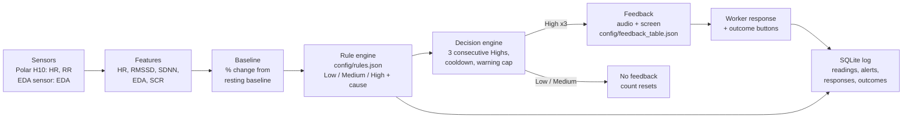

# Team 3: Frustration and fatigue prediction and feedback

**Team 3:** Palash, Andrew, Dean. **Repository:** [github.com/palash1031/VIP_psychological_dashboard](https://github.com/palash1031/VIP_psychological_dashboard) (branch `feature/polar-h10-dashboard`).

The system predicts **Low, Medium or High** frustration risk and fatigue risk from wearable data, and gives feedback under the rules shared by all teams:

- Medium (and Low) risk never triggers feedback.
- High risk triggers feedback only after **3 consecutive High predictions**. A Low or Medium prediction resets the count.

Stress prediction is out of scope.

## Pathway



## Input data and preprocessing

| Signal | Source | Processing |
| --- | --- | --- |
| HR (bpm) | Polar H10 | Mean over the rolling window |
| RMSSD, SDNN (ms) | Polar H10 RR intervals | RR outside 300–2000 ms excluded; successive differences never bridge an excluded beat; SDNN uses n − 1 |
| EDA (µS) | Separate EDA sensor (e.g. Empatica); the H10 has none | Mean over the rolling window |
| SCR (responses/min) | Derived from EDA | Peak detection: a rise of at least 0.01 µS from the preceding trough, counted when the signal turns down |

Each feature is converted to a percentage change from the participant's resting baseline, as the DBR masterfile specifies: `change % = (current − baseline) / baseline × 100`. A zero or missing baseline makes that feature unmeasured. **A missing signal is never treated as normal:** the prediction becomes *Unavailable* and names the missing signals.

The current feature window is the temporary 5-second debugging setting in `config/rules.json` (`featurePolicy`). Use a longer window, such as 60 s, for data collection.

## Prediction rules

All thresholds live in [`config/rules.json`](../config/rules.json), so they can be retuned without code changes. Every condition in a row must hold, comparisons are strict, and the highest matching level wins. Values below the Low thresholds are still predicted Low.

### Fatigue (DBR stress sheet, section 6, Fatigue-Related Stress)

| Level | RMSSD | SDNN | HR | EDA |
| --- | --- | --- | --- | --- |
| Low | < −15% | < −15% | | |
| Medium | < −25% | < −20% | | |
| High | < −35% | < −30% | < +10% | < +15% |

The High rule needs EDA. With only the Polar H10, fatigue can reach Medium, and the system reports that High cannot be assessed.

### Frustration (DBR frustration sheet)

The frustration sheet gives each cause as a pattern of arrows but no numbers. We converted each arrow using the stress-sheet row that has the **same arrow pattern**:

- Rework (↑↑ ↑↑ ↑ ↓ ↓) has the same pattern as Cognitive Overload.
- Schedule Pressure (↑ ↑ ↑↑ ↓↓ ↓↓) has the same pattern as Time Pressure.
- "Slight ↑" uses the caps from the Fatigue-Related row (HR < 10%, EDA < 15%).

The single-↑ SCR value is our assumption, because the stress sheet has no SCR value for a single ↑. We set it equal to single-↑ EDA.

| Arrow | Low | Medium | High | Taken from |
| --- | --- | --- | --- | --- |
| EDA ↑↑ | > 10 | > 20 | > 30 | Cognitive Overload |
| SCR ↑↑ | > 10 | > 25 | > 40 | Cognitive Overload |
| HR ↑ | > 5 | > 10 | > 15 | Cognitive Overload |
| RMSSD/SDNN ↓ | < −10 | < −15 | < −25 | Cognitive Overload |
| EDA ↑, SCR ↑ | > 10 | > 15 | > 25 | Time Pressure (SCR assumed equal to EDA) |
| HR ↑↑ | > 10 | > 15 | > 20 | Time Pressure |
| RMSSD/SDNN ↓↓ | < −10 | < −20 | < −30 | Time Pressure |
| slight ↑ (EDA, SCR / HR) | 0 to 15 / 0 to 10 | same | same | Fatigue-Related caps |

| Cause | EDA | SCR | HR | RMSSD | SDNN |
| --- | --- | --- | --- | --- | --- |
| Rework / Repeated Task Failure | ↑↑ | ↑↑ | ↑ | ↓ | ↓ |
| Schedule Pressure | ↑ | ↑ | ↑↑ | ↓↓ | ↓↓ |
| Equipment / Tool Problems | ↑↑ | ↑ | ↑ | ↓ | ↓ |
| Material Shortage / Waiting Time | slight ↑ | slight ↑ | slight ↑ | ↓ | ↓ |
| Poor Communication / Unclear Instructions | ↑↑ | ↑ | ↑ | ↓↓ | ↓↓ |

Frustration needs all five signals. When several causes match at the same level, the engine reports the most specific one: the rule with the strictest thresholds, measured as the sum of the absolute threshold values. The other matching causes are listed as "also consistent with", so they are not hidden. At Low risk the DBR specifies "any cause", so no cause is reported.

## Feedback logic

The decision engine is [`pipeline/decision.py`](../pipeline/decision.py) and its settings are in [`config/feedback_table.json`](../config/feedback_table.json):

1. A Low or Medium prediction never issues feedback and sets the High count to 0.
2. Each High prediction adds 1 to the count. On the 3rd consecutive High, feedback is issued for the predicted cause, and the count then restarts.
3. An Unavailable prediction, or a gap longer than 5 s between predictions, also resets the count, because consecutiveness cannot be confirmed.
4. To limit alarm fatigue, there is a 120 s cooldown per state and at most 3 alerts per 10 minutes. These two values are provisional study settings.

High feedback text is taken from the DBR masterfile:

| State | Cause | Message (spoken and shown) | Closed-loop task action |
| --- | --- | --- | --- |
| Frustration | Rework / Repeated Task Failure | "Pause and reassess the task. Work through one step at a time." | Temporarily simplify task; provide additional guidance |
| Frustration | Schedule Pressure | "Prioritize the next important step. Keep a consistent pace." | Reschedule lower-priority activities |
| Frustration | Equipment / Tool Problems | "Pause while the issue is addressed. Consider available alternatives." | Switch task or reassign equipment |
| Frustration | Material Shortage / Waiting Time | "Review upcoming activities and organize tools and materials." | Assign preparatory work |
| Frustration | Poor Communication / Unclear Instructions | "Verify the instructions before continuing." | Require task confirmation before execution |
| Fatigue | Fatigue-Related Stress | "Take a short recovery break if safe." | Trigger micro-break recommendation |

Feedback is delivered as on-screen text and through browser speech. The worker can answer with Acknowledge, I took a break or Not helpful, and can then report Better, The same or Worse. Every reading, alert, response and outcome is stored in a local SQLite database and can be exported as session JSON.

## Running it

```bash
python3 serve_dashboard.py
# Team 3 dashboard:   http://127.0.0.1:8000/serving/dashboard.html
# Polar H10 platform: http://127.0.0.1:8000/psychosocial_dashboard.html
python3 tools/demo_stream.py          # the same scripted demo in the terminal
```

The dashboard's scripted demo comes from [`config/demo_scenario.json`](../config/demo_scenario.json):

1. Rest: Low.
2. Frustration rises to Medium: no feedback.
3. Two Highs, then a Medium: the count resets.
4. Three Highs: frustration feedback.
5. Recovery.
6. Fatigue rises to Medium: no feedback.
7. Three High fatigue predictions: fatigue feedback.
8. Recovery.

"Try your own values" sends custom % changes. "Follow live Polar session" shows predictions from a connected H10.

## Testing

| Suite | Command | Result |
| --- | --- | --- |
| Python (rules, timing, pipeline, storage, API) | `python3 -m unittest discover -s tests -p 'test_*.py'` | 111 passed, 2 skipped (optional-dependency branches) |
| JavaScript (sensor decoding, HRV, browser rules) | `npm test` | 63 passed |
| Browser (built panel and real local API) | `npx playwright test` | 12 passed |

[`tests/test_pipeline.py`](../tests/test_pipeline.py) contains:

- one boundary check per frustration threshold (every cause and level, exact boundary versus just inside);
- the fatigue thresholds;
- cause selection for all five causes;
- one test per timing rule: Medium silent, 3rd High alerts, reset on Low, Medium, Unavailable and gaps, duplicates ignored, restart after an alert, cooldown, warning cap, configurable count;
- an end-to-end run of the scripted demo.

These tests check that the software follows the rules. They do not measure prediction accuracy, because no labelled frustration or fatigue data exists yet.

## Limitations

- **Accuracy is not yet validated.** The rules come from the DBR masterfile. The frustration thresholds are derived from stress-sheet rows with matching arrow patterns, not from frustration data. Accuracy, precision and recall can only be measured after labelled sessions are collected, using independent self-ratings with leave-one-person-out validation (`training/train_model.py`).
- **Causes overlap.** Several frustration patterns are subsets of others, and "slight ↑ with ↓ HRV" (Material Shortage) resembles the fatigue pattern. Physiology alone cannot tell causes apart reliably. The DBR's own architecture adds task context and shift duration, which are not yet inputs.
- **Polar-only sessions are limited.** The H10 has no EDA. Frustration is Unavailable and fatigue tops out at Medium unless an EDA sensor is connected.
- **SCR in short windows is coarse.** In a 5-second window, SCR rate changes in large steps, and a resting baseline with no responses leaves SCR unmeasured.
- **"Consecutive" depends on prediction rate.** At about one prediction per second, 3 consecutive Highs take about 3 s. The DBR's 60–120 s duration would correspond to roughly one prediction every 30 s.
- **No ML model is used yet.** Both states are rules-only. The pipeline can blend a trained model only when it beats the rules on held-out participants.

## Source files

| File | Role |
| --- | --- |
| [`config/rules.json`](../config/rules.json) | Thresholds for each state, cause and level |
| [`config/feedback_table.json`](../config/feedback_table.json) | Consecutive-High count, cooldown, warning cap, feedback text per level and cause |
| [`config/demo_scenario.json`](../config/demo_scenario.json) | Scripted demo |
| [`pipeline/features.py`](../pipeline/features.py) | HRV, SCR peak rate, baseline, % change |
| [`pipeline/rule_engine.py`](../pipeline/rule_engine.py) | Low/Medium/High and cause selection |
| [`pipeline/decision.py`](../pipeline/decision.py) | Consecutive-High feedback decisions |
| [`pipeline/feedback_pipeline.py`](../pipeline/feedback_pipeline.py) | Per-sample chain for frustration, fatigue and posture |
| [`serving/server.py`](../serving/server.py) | `/samples`, `/latest`, `/feedback`, `/summary`, `/export` |
| [`serving/dashboard.html`](../serving/dashboard.html) | Team 3 dashboard (display, audio, feedback buttons) |
| [`storage/sqlite_store.py`](../storage/sqlite_store.py) | Readings, alerts, responses, outcomes |
| [`training/build_feedback_table.py`](../training/build_feedback_table.py) | Builds the feedback table from a CSV/XLSX sheet ([`config/feedback_template.csv`](../config/feedback_template.csv)) |
| [`tools/demo_stream.py`](../tools/demo_stream.py) | Scripted replay without hardware |
| [`sensor/study-panel.js`](../sensor/study-panel.js), [`sensor/closed-loop-panel.js`](../sensor/closed-loop-panel.js) | Polar H10 platform panel |
| [`tests/test_pipeline.py`](../tests/test_pipeline.py) | Threshold, timing and end-to-end tests |
